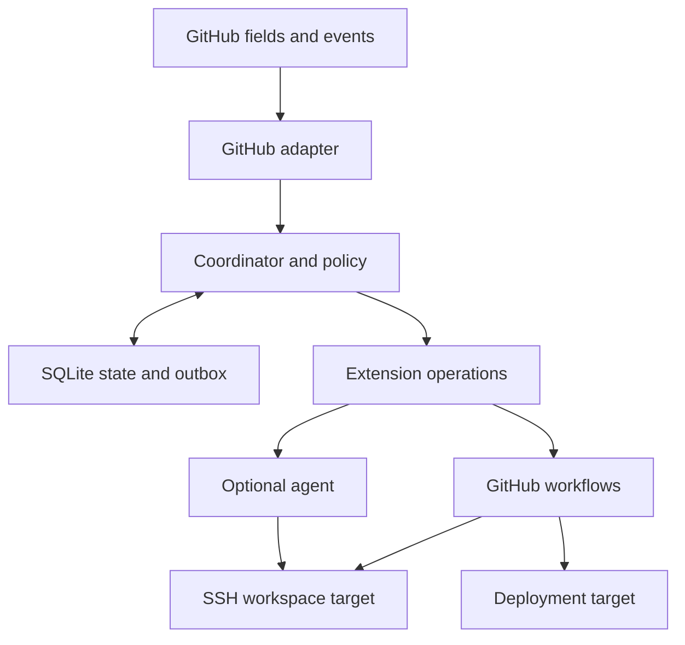

# 06 — Architecture

## Runtime

One Node.js coordinator process owns one SQLite database on a local durable filesystem. A CLI uses a local authenticated control socket/API. The coordinator exposes only configured authenticated HTTPS integration endpoints, not a dashboard. A reverse proxy or private-network route is deployment configuration; no control panel is required.

The domain layer depends on ports: state store, clock, identity provider, event source, projection writer, connector, action executor and session provider. GitHub, SSH, filesystem/process execution and optional agent implementations are adapters. Package boundaries must prevent imports from the core into provider implementations.

The diagram shows responsibilities, not mandatory network paths. A workflow may deploy to a cloud service while its related source workspace resides on SSH.

## Proposed package layout

packages/core, packages/contracts, packages/storage-sqlite, packages/provider-github, packages/connector-ssh, packages/action-github-workflow, packages/action-workspace-create, packages/action-workspace-delete; apps/coordinator and apps/cli. Packages begin in one public repository. The private agent implementation is a separate repo consuming released/pinned contracts.

## Processing loop

1. Authenticate an incoming event or fetch it through a configured reconciliation adapter.
2. Persist a bounded normalized event and delivery identity before acknowledging it.
3. Refresh current external state where required; evaluate actor, repository, target and rule permissions.
4. In a transaction, create/update the run and enqueue operation intents and projection intents.
5. Execute committed intents outside the database transaction.
6. Persist observation/receipt and an append-only transition event; enqueue follow-up work.

Network requests must not hold SQLite transactions. Use uniqueness constraints rather than in-memory checks to deduplicate. Outbox completion records survive process death. Secrets never enter event payloads or outbox arguments.

## Persistence model

| Table | Key information and constraints |
| --- | --- |
| installations | ID, schema/config revision, enabled state |
| bindings | Provider IDs, scope, field/type/option bindings, last resolution |
| events | Provider delivery ID or reconciliation fingerprint, actor, origin, source revision |
| requests | Provider issue ID, start transition generation; unique installation/issue/generation |
| runs | Request, state/version, config hash, source refs, current operation |
| workspaces | Run, target, resource locator, ownership proof reference, keep, lifecycle |
| resources | Workspace, resource type, provider ID, createdByOperation, cleanup policy |
| operations | Stable ID, action/version, canonical input hash, state, effect boundary |
| attempts | Operation, executor/run/attempt identity, timestamps, result/error |
| claims | Operation plus resource/target lock, fencing number, executor; unique active claim |
| sessions | Opaque extension/session ID, workspace, latest observed turn, owner state |
| approvals | Plan hash/revision, approving human ID, message/evidence reference |
| outbox | Intent, idempotency key, retry timing and last classified result |
| projections | Field ID, last observed/written value and expected version/fingerprint |
| audit | Actor, authorized operation, policy revision, transition and evidence IDs |

Use foreign keys, migrations, UTC timestamps, monotonic versions, checked enum values and bounded JSON where extension-specific data is needed. Keep operational history outside disposable workspace directories.

## Technical design defaults

Single coordinator, two active workspaces initially, one active automation turn per session, one deploy per target environment, exponential backoff with jitter for transient reads, and 90-day metadata retention are initial design defaults rather than user-specified product constants. Limits are configurable and must be visible through CLI diagnostics.

SQLite is not a network-shared coordination service. A future multi-coordinator mode requires another storage/locking design. WAL/checkpoint/backup behavior and process recovery need execution evidence in W01.
